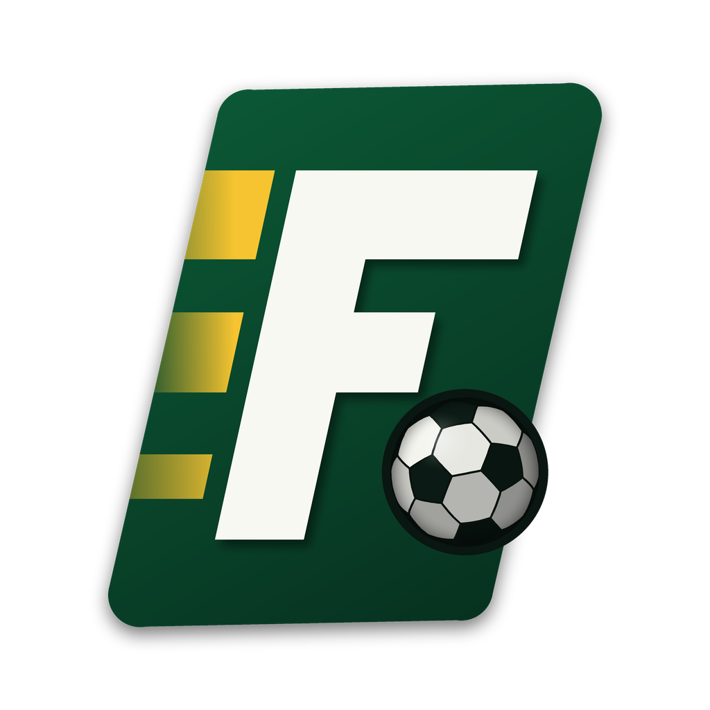
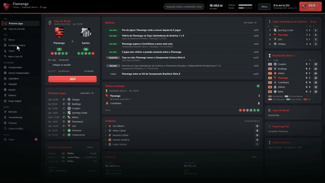
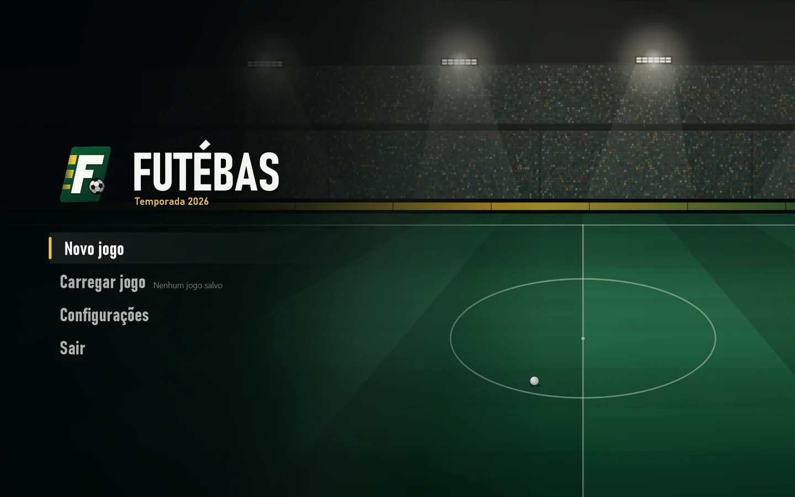
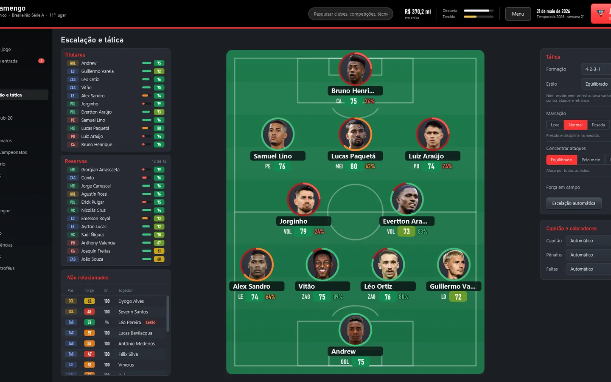
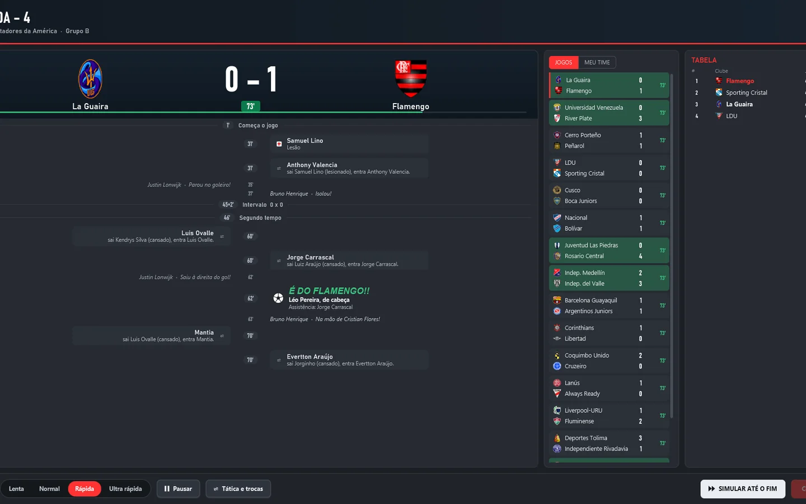
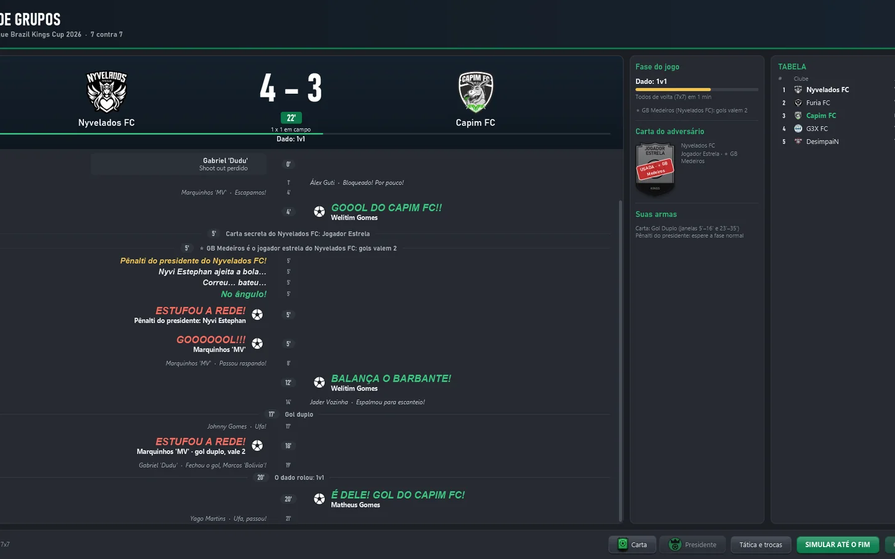
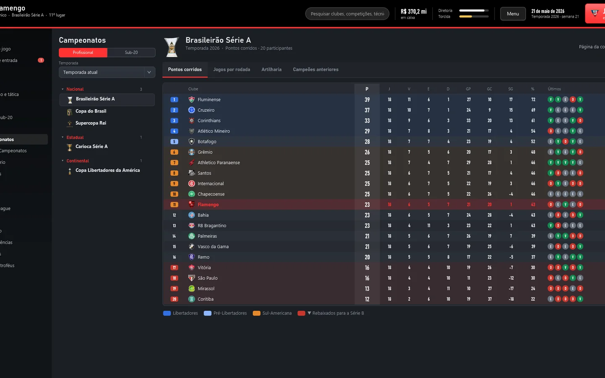
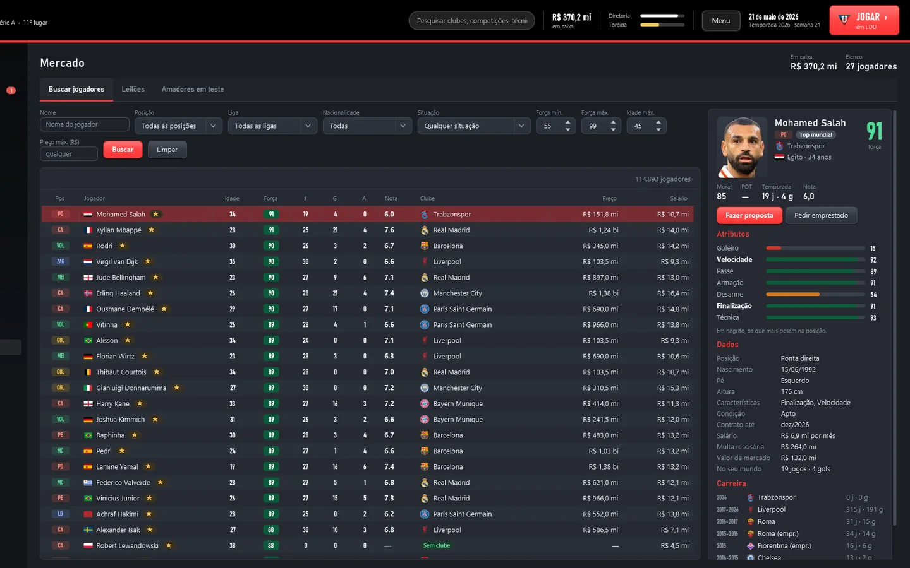
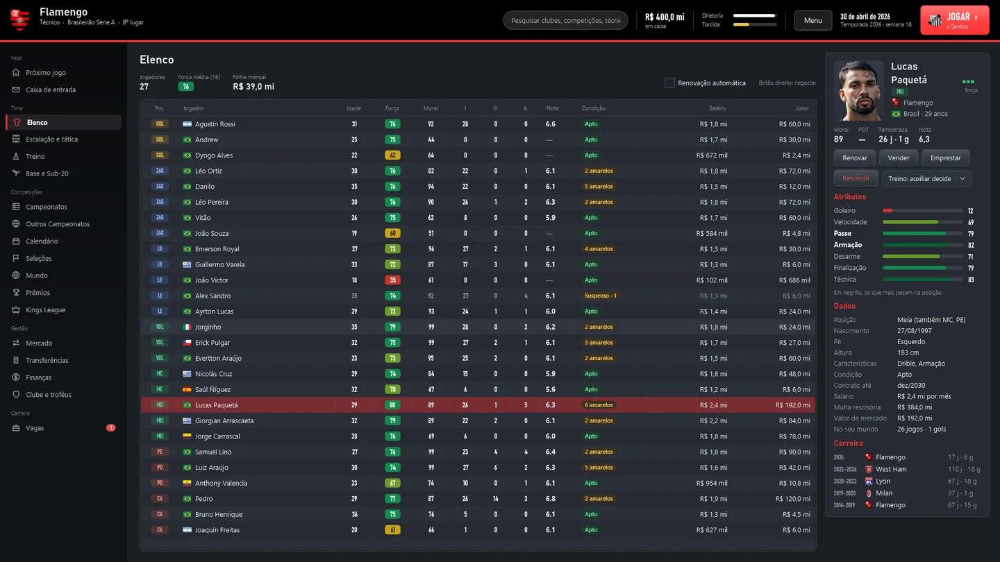
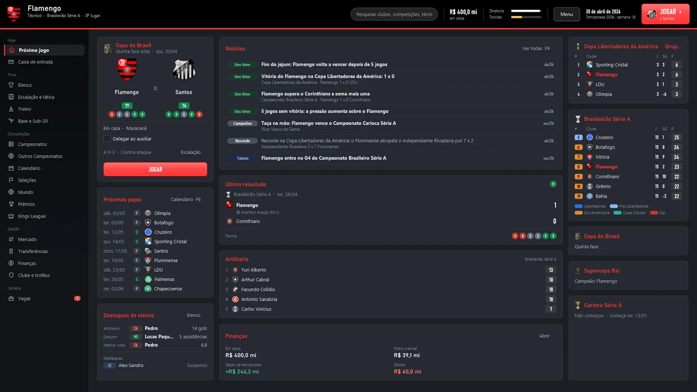

<p align="center">
  
</p>

<h1 align="center">FUTÉBAS</h1>

<p align="center">
  Jogo de técnico de futebol para desktop, com o mundo inteiro em 2026.<br>
  Java 21 · JavaFX · SQLite · Maven
</p>

<p align="center">
  
</p>

<p align="center"><a href="docs/trailer.mp4"><b>▶ Assista ao trailer completo</b></a></p>

---

## O que é

O FUTÉBAS é um jogo de técnico de futebol no espírito dos clássicos do gênero, como o Brasfoot.
Você escolhe um clube em qualquer país e assume o comando a partir de 1º de janeiro de 2026: monta
o time, negocia jogadores, cuida das finanças e acompanha as partidas lance a lance. Temporada após
temporada, o mundo segue sozinho, com títulos, acessos, rebaixamentos, transferências e novas
estrelas.

## Destaques

- **Mundo inteiro em 2026:** 224 países, 8.370 clubes, 192 mil jogadores e 640 competições, com
  ligas, copas nacionais, estaduais, torneios continentais, Mundial de Clubes e Copa do Mundo.
- **Partida ao vivo com motor próprio:** placar, narração, estatísticas, os outros jogos da rodada e
  a tabela atualizando em tempo real; substituições, troca de posições e mudanças táticas durante o
  jogo.
- **Tática:** formações, campo com arrastar e soltar, estilo de jogo, marcação e concentração dos
  ataques, capitão e batedores.
- **Mercado:** busca de jogadores com filtros, propostas com taxa e salário, empréstimos, leilões e
  respostas assíncronas dos outros clubes.
- **Finanças:** receitas e despesas da temporada, projeção do caixa, estádio e empréstimos no banco
  com cronograma de parcelas.
- **Carreira e vagas:** o técnico pode ser demitido, receber propostas e se candidatar a vagas em
  outros clubes, inclusive de outros países, e também em seleções.
- **Dois técnicos no mesmo PC:** cada um com o seu clube, vez de cada um na rodada e partidas em tela
  dividida.
- **Kings League:** a liga de futebol 7 com draft, dado, carta secreta, gol duplo, shootouts e pênalti
  do presidente.

## Galeria

| | |
|---|---|
|  |  |
|  |  |
|  |  |
|  |  |

## Como compilar e rodar

Requisitos: **JDK 21** e **Maven 3.9+**.

```bash
# compilar e rodar os testes
mvn -f jogo/pom.xml test

# rodar o jogo (precisa de dados/mundo.sqlite; veja abaixo)
mvn -f jogo/pom.xml javafx:run
```

A base do mundo e os assets visuais não acompanham o repositório. Para testar o jogo sem eles, gere
um mundo fictício com `mvn -f jogo/pom.xml compile exec:java@mundo-ficticio`. Os detalhes, inclusive
como montar a base real com o pipeline de coleta, estão em [`docs/DADOS.md`](docs/DADOS.md).

No Windows, `tools/empacotar.sh` gera um executável (`dist/FUTEBAS/FUTEBAS.exe`) com o `jpackage`.

## Estrutura

```
jogo/                  aplicação Java (Maven)
  src/main/java/br/futebas/
    partida/           motor da partida (chances, gols, cartões, cansaço, pênaltis)
    competicao/        formatos de liga e copa, calendário, desempates, torneios continentais
    mundo/             clubes, jogadores, contratos, simulação semanal, saves
    ia/                mercado, negociações, diretorias e técnicos dos outros clubes
    financas/          receitas, salários, estádio e banco
    kings/             Kings League: draft, regras e motor do futebol 7
    selecao/           seleções nacionais, eliminatórias e Copa do Mundo
    historia/          notícias, recordes, lendas e campeões históricos
    dados/             leitura da base do mundo (SQLite)
    ui/                interface JavaFX (telas, componentes e tema)
  src/test/java/       testes JUnit 5
coleta/                pipeline em Python que monta a base do mundo
tools/                 scripts de build, empacotamento e geração do logo
docs/                  arquitetura, contrato de dados, manual e notas técnicas
```

## Testes

São 80 classes de teste com JUnit 5 (motor, competições, mercado, carreira, Kings League e telas),
que rodam sobre um mundo fictício gerado na hora, sem depender da base real. Alguns testes
verificam formatos reais de competições e são pulados automaticamente quando `dados/mundo.sqlite`
não existe.

```bash
mvn -f jogo/pom.xml test
```

Resultado atual: **249 testes, 244 passando e 5 pulados** (os que dependem da base real ou dos assets), sem falhas.

## Documentação

- [Manual do jogo](docs/MANUAL.md)
- [Arquitetura](docs/arquitetura.md) e [contrato de dados v2](docs/arquitetura-v2.md)
- [Dois técnicos no mesmo PC](docs/multitreinador.md)
- [Desempenho](docs/DESEMPENHO.md)
- [Dados do mundo](docs/DADOS.md)

## Licença

[MIT](LICENSE) © 2026 Guilherme Matzembacker.

FUTÉBAS é um projeto pessoal e não tem relação com clubes, ligas ou marcas citadas. Nomes de clubes,
competições e jogadores aparecem apenas como referência.
